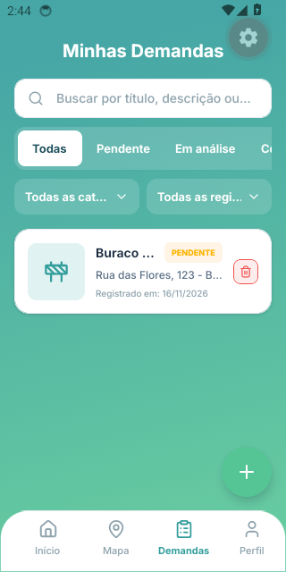
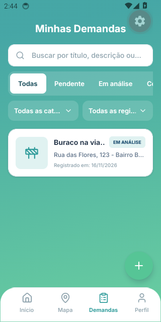
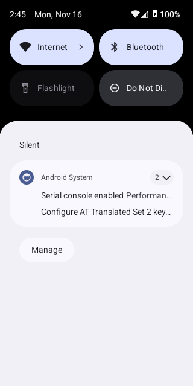

# Evidência: E2E-13, o gestor muda o status e o cidadão vê (ou não) a notificação

**Data:** 16/11/2026
**Ficha do cenário:** [`docs/e2e/e2e13-notificacao-de-status.md`](../e2e/e2e13-notificacao-de-status.md)
**Workflow:** `e2e-app` (`.github/workflows/e2e-app.yml`)
**Alvos:** app [`PetersonNave/Smart-City`](https://github.com/PetersonNave/Smart-City)
(commit `32ff0a8`) no Expo Go, num emulador Android 14, e back-end real
[`ndrfelipe/smart-city`](https://github.com/ndrfelipe/smart-city) (commit `d7b60aa`)

## 1. Resultado

Execução de referência: [#14](https://github.com/Ev-maers/resolveai-testes/actions/runs/43888036400)
(commit da suíte `979218a`).

| Passo | Onde | Resultado |
| :--- | :--- | :--- |
| 1. A cidadã entra no app e vê a demanda "Pendente" | Interface | Passou |
| 2. O gestor muda o status para `IN_PROGRESS` | API | Passou |
| 3. A cidadã puxa a lista e vê "Em análise" no cartão | Interface | Passou |
| 4. A notificação aparece na gaveta e abre o detalhe | Interface | **Reprovou: a notificação nunca aparece (D-14)** |

O quality gate reconheceu a reprovação como o defeito conhecido D-14, porque
a mensagem tem a assinatura registrada (a notificação não aparece na gaveta).
Por isso o job ficou verde, com a anotação:

```
Defeitos conhecidos do produto (nao bloqueiam o merge)
D-14 O app nao avisa o cidadao da mudanca de status no Expo Go para Android (1 teste(s), prazo 2026-11-30)
```

## 2. O que a cidadã vê

| Passo 1: a demanda pendente | Passo 3: o status novo na lista | Passo 4: a gaveta, sem o aviso |
| :---: | :---: | :---: |
|  |  |  |

O vídeo da execução inteira está na branch `metricas`:
[`e2e-app/execucao-14/e2e13-execucao.mp4`](https://github.com/Ev-maers/resolveai-testes/blob/metricas/e2e-app/execucao-14/e2e13-execucao.mp4).
As capturas de todas as execuções ficam em `e2e-app/execucao-<número>/`, na
mesma branch.

## 3. Diagnóstico

A interface mostrou o sintoma: a lista tem o status novo, mas o aviso não
chega. O diagnóstico publicado pela esteira mostrou que o canal de notificação
"demandas" do app nunca foi criado e que o app nunca pediu a permissão de
notificação. Como o app engole o erro (`.catch(() => {})` em
`src/notifications/useDemandNotifications.ts`), uma execução de diagnóstico
([#13](https://github.com/Ev-maers/resolveai-testes/actions/runs/43885374232))
acrescentou um registro temporário no log, só na cópia do app usada por aquela
execução. O registro já foi removido. O log do JavaScript do app
([`e2e-app/execucao-13/logcat-js.txt`](https://github.com/Ev-maers/resolveai-testes/blob/metricas/e2e-app/execucao-13/logcat-js.txt))
mostrou:

```
[E2E-13 diag] modo: null gestor=false
[E2E-13 diag] registro falhou: Error: Call to function 'ExpoNotificationChannelManager.setNotificationChannelAsync' has been rejected.
→ Caused by: java.lang.NullPointerException: Attempt to invoke virtual method 'java.lang.Class java.lang.Object.getClass()' on a null object reference
```

**Leitura.** No Expo Go para Android, a criação do canal é rejeitada no código
nativo. O app desiste do registro de notificações em silêncio, nunca liga o
aviso local e a cidadã não é avisada. O README do app declara justamente esse
ambiente como suportado ("o app usa notificações locais" no Expo Go).

## 4. Classificação e encaminhamento

| Etapa | Registro |
| :--- | :--- |
| Classificação | Defeito do SUT (app), severidade média: função central sem aviso ao usuário, sem expor nem corromper dado |
| Registro | D-14 em `data/defeitos-conhecidos.js`, com assinatura: só a falha em que a notificação não aparece |
| Encaminhamento | Squad do app (`PetersonNave/Smart-City`), prazo de 30/11/2026. Caminhos possíveis: tratar a falha do canal e seguir com o canal padrão, ou validar o aviso numa build de desenvolvimento |
| Issue do defeito | [#28](https://github.com/Ev-maers/resolveai-testes/issues/28), aberta pela esteira com `defeito-conhecido`, `defeito-sut` e `severidade:media` |
| Issue do teste | [#12](https://github.com/Ev-maers/resolveai-testes/issues/12), fechada pela esteira na execução #14: "Triagem concluida: defeito do produto, registrado como D-14 [...]. O acompanhamento segue na issue #28." |

## 5. O caminho até aqui

O cenário passou por várias execuções até chegar ao passo 4. Cada falha
anterior foi da própria automação, foi diagnosticada pelas capturas e pelos
logs publicados na branch `metricas` e foi corrigida sem reexecução automática:

| Execução | Onde parou | Causa | Correção |
| :--- | :--- | :--- | :--- |
| #5 a #7 | Login | A dica e o menu do Expo Go cobriam o app; o teclado cobria o campo de senha | Tratar a dica e o menu; fechar o teclado e rolar até o campo |
| #8 | Passo 4 | A notificação não apareceu | Investigação (abaixo) |
| #9 a #11 | Depois do login | A espera pelo pedido de permissão, que o app nunca fez | O pedido passou a ser tratado só se aparecer |
| #12 | Abertura do app | O Expo Go recarregou o app sozinho e ficou preso no carregamento | Oscilação de ambiente (risco R-07); não se repetiu |
| #13 | Depois do login | Execução de diagnóstico | Revelou o erro do canal (seção 3) |
| #14 | Passo 4 | D-14, reconhecido pelo gate | — |
